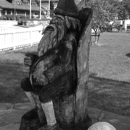

# Inverted Residual Convolutional Neural Network for Image Steganalysis
*How confident are you about the images you see? Do you look at the unseen, its echo screams throughout the ocean of greys?*  
~ Arino Jenynof, a former master's student at ITS

# Introduction
This repository contains the implementation of my  unpublished (and probably will never be published) master's thesis. This thesis attempts to do image steganalysis, which is an analysis (duh) done to some image to discover the probable hidden data inside it. The analysis is broad, you can do just classifying ("is this image probably tampered?"), marking which pixels are modified to accomodate secret data (iow., recognising steganographic noise patterns), or even attempts to extract secret data themselves.

Of course extracting the data is the hardest of them all. That means recognising how the steganograhy method hides them and reversing it. There are, in my opinion, infinite ways to embed secret into images, limited only by the steganography designers (and their AI companion perhaps) mind and imagination. Does this means detecting hidden data is an impossible task? Well, probably. Doesn't stop people from doing it, and we can get close enough.

Given a labelled group of clean, cover image and tampered, stego image, we can leverage Machine/Deep Learning (ML/DL) to map out the embedding function. We can only maps (i.e., approximating) because all we know is the input and the output. This needs a LOT of cover-stego samples, more samples means more ways to discover relationship between input and output. More ways means the ML/DL model itself needs to be expressive enough.

To demonstrate, how can you know one of them is a plain image and another hides part of someone private files?  
   
(*I swear those two images ARE different*)

# Related Works
These are the works that I referenced/studied/inspired by. Most are deep learning models. These include, but not limited to:
1. **Subtractive Pixel Adjacency Matrix (SPAM)**[^1] and **Spatial Rich Model (SRM)**[^2]

   Two of the early model using ML. Not even a model per se, these two are feature extractor for SVM classifier (SPAM) and ensemble classifier (SRM)[^3].

2. **Qian-Net**[^4]

   Early DL model which apparently inpires many others. Three subsection; pre-processing, convolution, and classifier. One 5×5 SQUARE filter is reused from SRM in pre-processing subsection.

3. **Zhu-Net**[^5]

   Use depth-wise convolution to reduce model parameter. Three layers just like Qian-Net, but uses 30 filters, instead of only one, from SRM.

4. **GBRAS-Net**[^6]

   Depth-wise separable, spatial pyramid pooling, and not using any fully-connected layer.

5. And others that I forgot. Or where the links have escaped me.

# Methodology
As is common in deep learning, to create a model capable of predicting the presence of hidden data needs atleast three components; Training-validation-testing data, model definition itself, and training strategy. Bad data means you won't learn much, not expressive or ***too*** expressive model makes training erratic, and incorrect training means reduction in accuracy/loss/whatever metric you choose to measure.

## Training Data
10.000 cover images from *Break Our Watermarking System 2* (BOWS2)[^7] and another 10.000 *Break Our Streganographic System* (BOSS)[^8]. All images have 512×512 dimension, greyscale, and saved in `.PGM` format.

### Images Processing
Those 20.000 images are not readily usable for training. Especially they're only cover images. First we [resize](#resizing-the-images) the images and [embeds](#embedding-secret-data) secret data into resized images.

#### Resizing the images
Cited works, except Qian-Net, downscaled the images into 256×256. The rationale was 512×512 is too big. My thesis downscales them too, but with three different downscaling method as I found something interesting. The methods are:
1. Nearest-neighbour
2. Bicubic
3. Bilinear

Unfortunately training with bilinear is incomplete.

#### Embedding secret data
After resizing, then you need to create stego images. Using the [MATLAB/GNU Octave scripts in this repo](scripts/datasets) you can create 20.000 stego images from the given cover images. See the [README.md](scripts/datasets/README.md) there for more info.

## Model Definition
Inspired by EfficientNet/MobileNet family. My model combines some of MobileNet features with steganalysis-specific design, namely:
1. Inverted Residual (*surprise title drop*), which uses Depth-wise separable convolution inside it.
2. Squeeze-and-Excite (SE)
3. Spatial Pyramid Pooling (SPP)
4. Spatial dimension is not aggresively reduced. As steganography depends very much on the condition of a pixel and its neighbours, reducing the spatial dimension too fast makes this connection harder to learn.
5. Does NOT normalise images to `µ = 0` and `σ = 1`, at least initially. There is always a BatchNorm operation after convolution operation. The types of steganography used in this thesis is called ±1 embedding. Meaning the changed pixel value is either added 1 or subtracted 1 from its original. This is a very, ***very*** low change, and normalising it to float means you're at the mercy of floating-point accuracy.

My model have three layers, like Qian-Net, Zhu-Net, GBRAS-Net, and other models from the era. See [`models.py` module](src/invresnet_steganalysis/models.py) for the nitty gritty.

### Pre-processing Layer
30 convolution filters with the weights initialised with filters from SRM, 17 3×3 filters and 13 5×5 filters. Another HardTanH to clamp the values between (-3, 3) which is common in my observation. I don't know where numbers came from.

### Convolutional Layer
The bread-and-butter of deep learning model. Two inverted residual blocks followed by average pooling to downscale the spatial dimension, except the last one which of course use SPP. Using SPP at the very end means in case of modification in other parts of convolutional layer, the output of it stays the same. This means classification layer can be reused, although the efficiency doing this is unknown. This layer is basically MobileNet but handcrafted.

### Classification Layer
Simple linear layer and dropout as regularisation. As this is a binary classification problem, I just use a single output. Oher works use two output which are then go through SoftMax to get each classes' probability. Single output is simpler, just use Sigmoid on the logits to get the probability of a given image is a stego image. Interpretation of this is probably in two class prediction some input `X` maybe got prediction of 75% class A and 25% class B. Whilst in binary class prediction  75% of input `X` means just class A. Is it 25% class B? Well the model doesn't know about that. Low percentages just mean the model is convinced that `X` is not A, not necessarily a B. Could be C, D, etc. Based on that I reckon image cannot be both a cover and stego, that would be silly. So I just choose the lazy option, stick on binary class prediction.

### Complete Layers Listing
Explaining why inverted residual (InvRes) has 3 directed output is longer than I want to explain, so I urge you to just read the original source, MobileNetV2[^9]

| Input (*ch*, *h*, *w*) | Block           | Output (*ch*)  | Output (*h*, *w*) | Use SE | Activation      | Stride |
| ---------------------- | --------------- | -------------- | ----------------- | :----: | --------------- | :----: |
| 1, 256, 256            | ConvSRM         | 30             | 256, 256          |        | HardTanh(-3, 3) | 1      | 
| 30, 256, 256           | InvRes          | 30 -> 36 -> 30 | 256, 256          |        | HardTanh(-1, 1) | 1      | 
| 30, 256, 256           | InvRes          | 30 -> 48 -> 30 | 256, 256          |        | SiLU            | 1      | 
| 30, 256, 256           | AvgPool         | 30             | 128, 128          |        |                 | 2      |  
| 30, 128, 128           | InvRes          | 30 -> 48 -> 40 | 128, 128          |        | SiLU            | 1      | 
| 40, 128, 128           | InvRes          | 40 -> 54 -> 40 | 128, 128          |        | SiLU            | 1      | 
| 40, 128, 128           | AvgPool         | 40             | 64, 64            |        |                 | 2      | 
| 40, 64, 64             | InvRes          | 40 -> 54 -> 50 | 64, 64            |        | SiLU            | 1      | 
| 40, 64, 64             | InvRes          | 40 -> 72 -> 50 | 64, 64            | ✓      | SiLU            | 1      |
| 50, 64, 64             | AvgPool         | 50             | 32, 32            |        |                 | 2      |
| 50, 32, 32             | InvRes          | 50 -> 72 -> 60 | 32, 32            | ✓      | SiLU            | 1      |
| 60, 32, 32             | InvRes          | 60 -> 84 -> 60 | 32, 32            | ✓      | SiLU            | 1      |
| 60, 32, 32             | AvgSPP + MaxSPP | 2520           |                   |        |                 | 1      |
| 2520                   | Linear          | 1260           |                   |        |                 |        |
| 1260                   | DropOut         | 1260           |                   |        |                 |        |
| 1260                   | Linear          | 1              |                   |        |                 |        |

## Training Strategy
Training strategy largely follows other works with small changes. Absolutely no optimisation was done in choosing the hyperparameter.

### Training on Nearest-neighbour
Nearest-neighbour needs transfer learning from higher payload. If the targeted payload is 0,4 bpp, training at 0,4 bpp directly results in no increase on accuracy. So, train first at 1,0 bpp, find the best model in terms of cross entropy loss and accuracy, and use that best model to do transfer learning at 0,8 bpp. Continue until you get to 0,4 and 0,2 bpp.

### Training on Bicubic and Bilinear
Just train directly on 0,4 and 0,2 bpp. This is pretty much how the cited works done their training. Which makes you wonder why nobody train on nearest-neighbour.

### Dataset Splitting
Images from BOSS are splitted into 4.000-1.000-5.000 images for training-validation-test split. Kind of weird, as usually the largest split is on the training split. To add training data, 10.000 images from BOWS2 are placed there. Final result is 14.000-1.000-5.000. This means images from BOWS2 are not represented at all on validation-test split. The effect is unknown, although this could be explained as an attempt to do a lite cross-dataset testing. Although in my opinion mixed source at validation-test split is better, but I was discouraged to do it. I was told to just do like other works because, apparently, there is little to gain at modifying dataset split.

### Optimizer, Scheduler, and Hyperparameters
Pretty standard, not much of a "novel" training here. This includes:
1. SGD optimizers, with:
   1. Learning rate $`= 0.0001`$
   2. Momentum $`= 0.9`$
   3. Weight decay $`= 0.00001`$
2. Optimizing function with Binary Cross Entropy
3. OneCycle Learning rate scheduler, maximum learning rate of $`0.01`$
4. 100 training epochs

# Experimental Result
There are a few formats to follow if you want to run the training yourself.
1. Images are packed into `.tar` file and named:
   1. `{dataset source}-cover-{downscaling method}.tar` for cover images
   2. `{dataset source}-{steganalysis method}-{payload}-{downscaling method}.tar` for stego images
2. Examples:
   1. `BossBase-cover-Bicubic.tar`, `BOWS2-cover-Bilinear.tar`
   2. `BossBase-S_UNIWARD-0,4bpp-Bicubic.tar`, `BOWS2-WOW-1,0bpp-Nearest.tar`
3. Every `.tar` is in the same folder.

## Preparation
Before you can run this experiment, make sure you have prepared the dataset and have:
1. Dedicated GPU (sorry Intel UHD Graphics user),
2. or access to one (Colab or anything else).

Needless to say you don't want to run training with CPU. After the hardware then you need:
1. Python 3.15 (I use lazy import),
2. RAM for about 12GB if you choose to cache the dataset on RAM.
3. VRAM, the bigger the better so you can have bigger batches.
3. This repo as installed/editable install.

You can install this package by cloning first
```batch
git clone --depth 1 https://github.com/ArinoJenynof/invresnet_steganalysis.git
python -m pip install -e invresnet_steganalysis
```
Or just install straight from git
```batch
python -m pip install "invresnet_steganalysis @ git+https://github.com/ArinoJenynof/invresnet_steganalysis.git"
```
For CUDA support go to [PyTorch download section](https://pytorch.org/get-started/locally/) and take notes of the `--index-url` argument. Add that to the previous command, e.g.
```batch
git clone --depth 1 https://github.com/ArinoJenynof/invresnet_steganalysis.git
python -m pip install -e invresnet_steganalysis --index-url https://download.pytorch.org/whl/cu126 --extra-index-url https://pypi.org/simple
```
Modify according to your hardware capabilities. After all said and done run
```batch
python -m invresnet_steganalysis -h
```
to know what you can do with this package. Of course the interface is quite simplistic, pull requests welcome :grin:

## Results
After training has been concluded, the model is tested on test split to see how accurate it is. Compared with other works the result aren't too shabby if I say so myself. I haven't see newer works on nearest-neighbour except the cited work. Bilinear hasn't done yet but my time is up so it's unfinished.

### Nearest-neighbour

| Model | S_UNIWARD<br/>0,4 bpp | <br/>0,2 bpp | WOW<br/>0,4bpp | <br/>0,2bpp  |
| --- | --- | --- | --- | --- |
| InvResNet | 77,8% | 67,1% | 80,6% | 70,0% |
| SRM[^10] | 60,9% | 54,4% | 62,3% | 56,5% |
| XuNet[^10] | 51,0% | 50,2% | 51,4% | 50,5% |
| SRNet[^10] | 51,6% | 50,0% | 78,6% | 50% |

### Bicubic

| Model | S_UNIWARD<br/>0,4 bpp | <br/>0,2 bpp | WOW<br/>0,4bpp | <br/>0,2bpp  |
| --- | --- | --- | --- | --- |
| InvResNet | 93,50% | 85,20% | 94,01% | 88,08% |
| HSMNet[^11] | 91,81% | 81,45% | 94,50% | 86,00% |
| PSDR-SRNet[^12] | 91,71% | 81,90% | 91,76% | 86,21% |
| SRM + Gabor filter[^13] | 90,80% | 83,20% | 89,60% | 79,80% |
| SWT-SN[^11] | 89,22% | 82,17% | 90,85% | 85,12% |
| Depth-wise separable CNN[^14] | 84,60% | 76,70% | 90,70% | 82,10% |

### Bilinear

| Model | S_UNIWARD<br/>0,4bpp |
| --- | --- |
| InvResNet | 77,46% |
| SRNet[^10] | 93,80% |

# Conclusion
What a wild ride, huh? There are, *of course*, somethings that I question, others that I still don't understand, etc. But because I'm done, I'm out. Check out the [weights here](https://drive.google.com/drive/folders/1olQCrlah7qZzpFmAXElwxv3QkTK4qAaH?usp=sharing) for the `state_dict` of the trained model that I've done. You can load those yourself to do some more experimenting. Model definitions are in [`models.py` module](src/invresnet_steganalysis/models.py). And that's it, go wild cowboys! :cowboy_hat_face: :rose:

[^1]: http://ws2.binghamton.edu/fridrich/Research/paper_6_dc.pdf
[^2]: http://dde.binghamton.edu/kodovsky/pdf/TIFS2012-SRM.pdf
[^3]: https://dde.binghamton.edu/download/ensemble/TIFS-2011-ensemble.pdf
[^4]: https://doi.org/10.1117%2F12.2083479
[^5]: https://github.com/1204BUPT/Zhu-Net-image-steganalysis.git
[^6]: https://github.com/BioAITeam/Steganalysis.git
[^7]: https://web.archive.org/web/20130510185330/http://bows2.ec-lille.fr/
[^8]: https://dde.binghamton.edu/download/
[^9]: https://doi.org/10.1109/CVPR.2018.00474
[^10]: https://doi.org/10.1109%2FACCESS.2020.3033814
[^11]: https://doi.org/10.1016/j.ins.2025.122824
[^12]: https://doi.org/10.1016/j.jvcir.2025.104542
[^13]: https://doi.org/10.1016/j.jisa.2024.103864
[^14]: https://doi.org/10.1186/s42400-023-00156-x